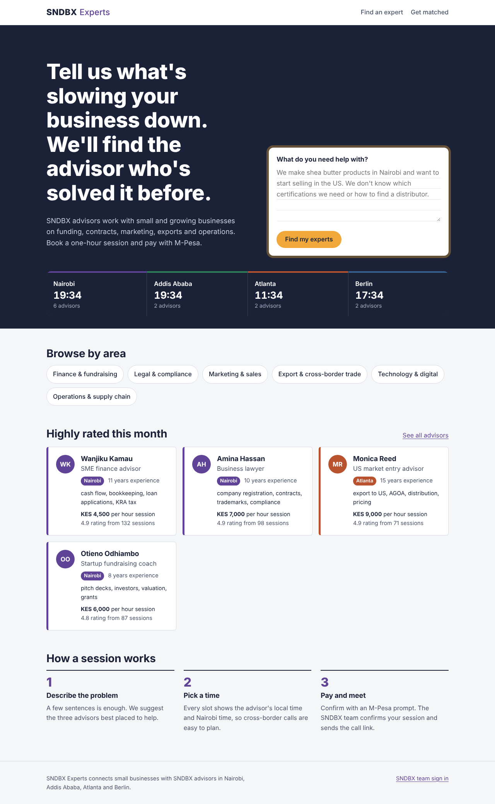
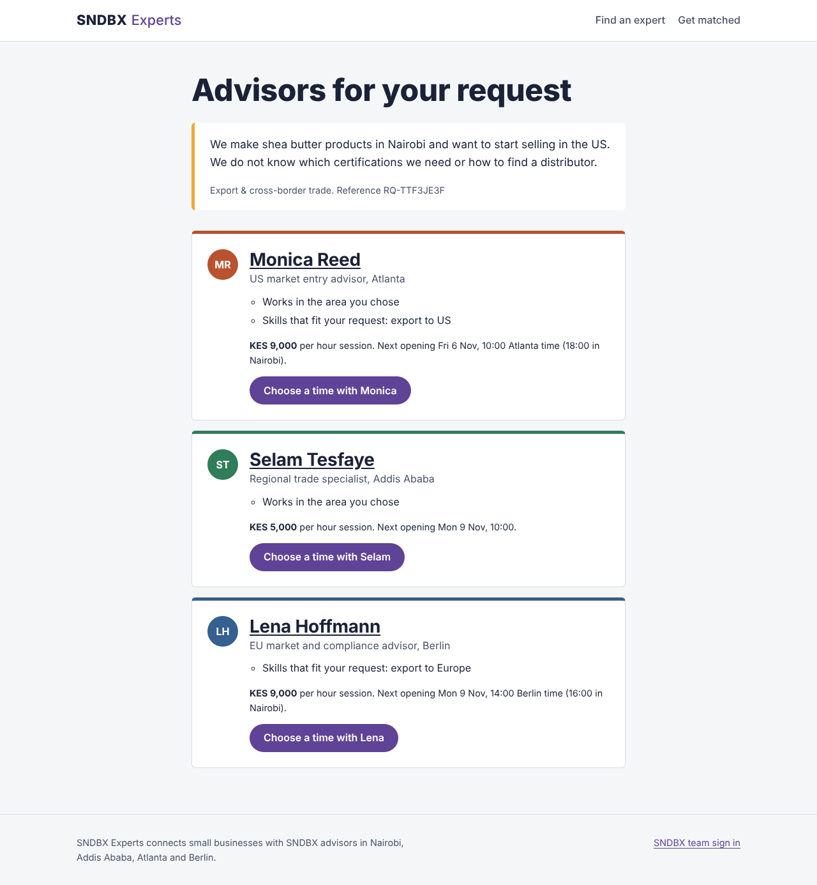
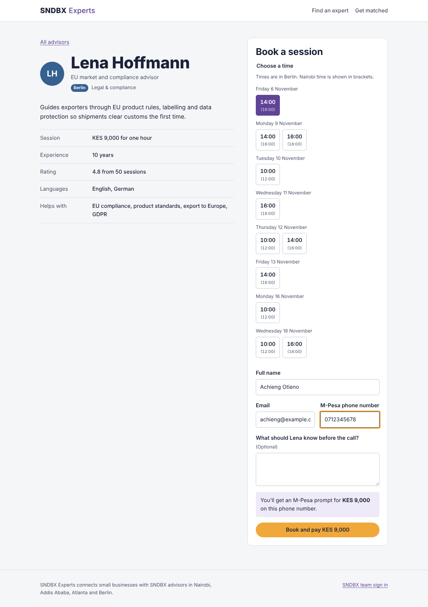
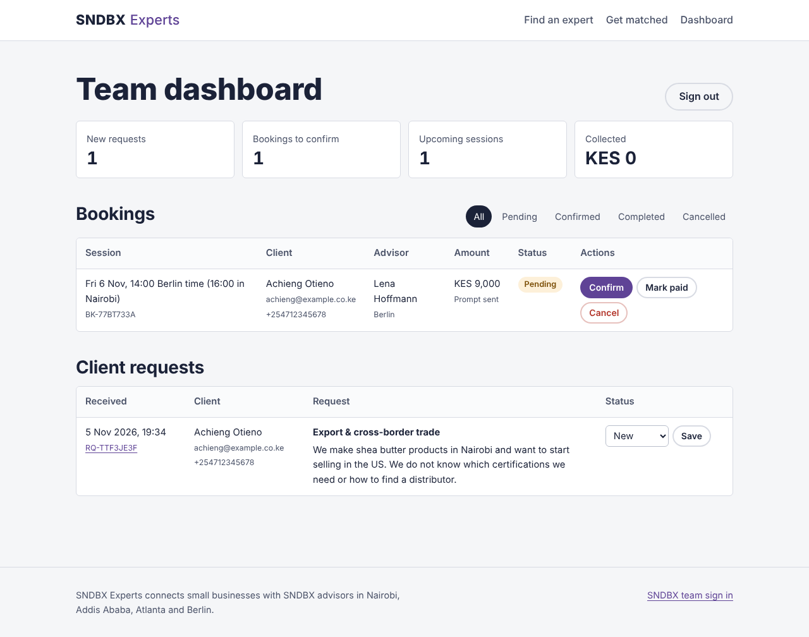

# SNDBX Experts

A marketplace MVP that connects small businesses with SNDBX advisors in Nairobi, Addis Ababa, Atlanta and Berlin. A client describes a problem, gets matched with the advisors best placed to help, books a one-hour session and pays with M-Pesa. The SNDBX team confirms sessions and tracks payments from a dashboard.



## What it does

**For clients**
- Describe a problem in plain words and get up to three matched advisors, each with the reasons they fit
- Browse and filter the directory by area, hub and keyword
- See each advisor's open times in their local time, with Nairobi time alongside for cross-border calls
- Book a slot and receive an M-Pesa payment prompt (simulated in this MVP)
- Keep a booking link to check status later

**For the SNDBX team** (`/admin`)
- See new requests, bookings to confirm, upcoming sessions and money collected
- Confirm, complete or cancel bookings; cancelling frees the advisor's slot
- Mark payments received and update request status

| Matching | Booking | Team dashboard |
|---|---|---|
|  |  |  |

## Run it locally

You need Python 3.10 or newer.

**macOS / Linux**
```bash
python3 -m venv .venv
source .venv/bin/activate
pip install -r requirements-dev.txt
flask --app app seed          # creates the database with 12 demo advisors
flask --app app run --debug
```

**Windows (PowerShell)**
```powershell
py -m venv .venv
.venv\Scripts\Activate.ps1
pip install -r requirements-dev.txt
flask --app app seed
flask --app app run --debug
```

Open http://127.0.0.1:5000. The team dashboard is at `/admin`; the default password is `sndbx-admin`. Set `ADMIN_PASSWORD` before showing it to anyone.

Run the tests with `pytest`. There are 30 covering pages, booking, double-booking protection, validation, CSRF, matching, phone formatting and the admin flow.

## Deploy

The repo includes `render.yaml` for Render's free tier: push to GitHub, then in Render choose **New > Blueprint**, pick the repo and set `ADMIN_PASSWORD`. The start command is `gunicorn "app:create_app()"`, so it also runs on Railway, Fly.io or any VPS.

On free hosts the disk resets on each deploy, so bookings disappear. That is fine for a demo; for real use, move to PostgreSQL (see roadmap).

## How it's built

| Part | Choice | Why |
|---|---|---|
| Web framework | Flask 3 | Small, readable, easy for a new team member to follow |
| Database | SQLite via the standard library | No setup; schema is plain SQL so it ports to PostgreSQL |
| Templates | Jinja, server-rendered | Fast on low-end phones and slow connections; no build step |
| Styling | One hand-written CSS file | Hub colours, mobile-first, accessible focus states |
| Payments | Provider interface with a simulated M-Pesa | Full flow works now; swap in Daraja without touching routes |

```
app/
  __init__.py     app factory, config, template filters
  public.py       directory, profiles, matching, booking
  admin.py        team dashboard and status changes
  matching.py     rule-based, explainable expert matching
  payments.py     M-Pesa provider interface and phone formatting
  security.py     CSRF tokens, admin login, booking references
  db.py           SQLite connection and CLI commands
  schema.sql      tables: experts, availability, client_requests, bookings
  seed.py         demo advisors (fictional) and open slots
  constants.py    hubs, categories, keywords
  templates/      Jinja pages
  static/         style.css
tests/            pytest suite
```

### Matching

`matching.py` scores each advisor against the request: 5 points for the right area, 2 per skill that appears in the client's description, 1.5 for the preferred hub, and up to 1 more for a high rating. Location and rating only rank advisors; they never make an irrelevant one appear. Every point produces a reason the client can read, which builds trust and makes the ranking easy to debug. If the client leaves the area blank, it's guessed from keywords in their description.

### Safety details worth knowing

- **No double bookings.** A slot is claimed with `UPDATE ... WHERE is_booked = 0` and the row count is checked, so two people clicking at once can't both get it.
- **CSRF tokens** on every form, constant-time password comparison, and login redirects restricted to the admin area.
- **Unguessable references** (`BK-7H3A5PZX`) for booking and request links instead of sequential IDs.
- **Phone numbers** are normalised to `2547XXXXXXXX`, the format M-Pesa's API expects.

## Roadmap

1. **Live M-Pesa.** Implement `DarajaMpesa.request_payment` with the Daraja STK Push API, add a callback route that marks bookings paid, and set `PAYMENT_PROVIDER=daraja`.
2. **Email and SMS notifications** for booking received, confirmed and reminders (e.g. Africa's Talking for SMS).
3. **Advisor accounts** so experts manage their own profiles, availability and session notes.
4. **PostgreSQL** with migrations, replacing `db.py`.
5. **Video links** generated per session (Google Meet or Zoom API).
6. **Reviews** collected after completed sessions, replacing the seeded ratings.
7. **Card payments** for clients outside Kenya.
8. **Smarter matching** using text embeddings once there's enough request history.

## Note

All advisors, ratings and session counts in the seed data are fictional placeholders for demonstration.
